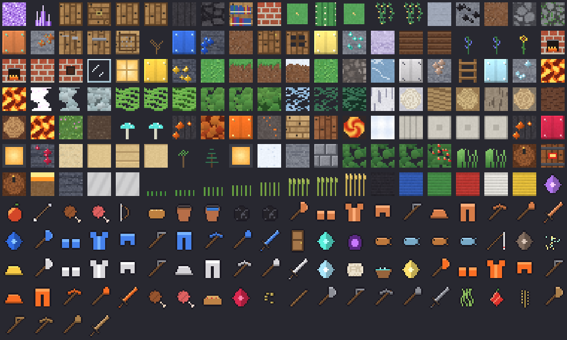

# ZperCraft Texturas (Minecraft Bedrock)

Resource pack con las texturas originales de ZperCraft, exportadas directamente del pintor de texturas del juego (`voxel/src/gfx/Atlas.ts` y `voxel/src/game/Items.ts`, rama `ccr-bed54efe-6zvh1l`).

**Instalar:** abre `release/ZperCraft_Texturas.mcpack` en el teléfono/PC → Minecraft lo importa solo → Ajustes → Recursos globales → activa *ZperCraft Texturas*.



## Equivalencias principales
| ZperCraft | Minecraft |
|---|---|
| Fresno (ash) | Roble |
| Pino | Abeto |
| Palma | Jungla |
| Plateado | Abedul |
| Escombro / musgoso | Piedra labrada / musgosa |
| Piedra profunda / pizarra | Pizarra profunda (cobbled/deepslate) |
| Solar (sunstone) | Oro |
| Azurita / herramientas azure | Diamante |
| Brillofragmento (glowshard) | Esmeralda |
| Escarcuarzo (frostquartz) | Lapislázuli |
| Rubelita | Redstone |
| Emberita | Netherita / cuarzo del Nether |
| Banco de trabajo / horno de arcilla / caja / barril de pólvora | Mesa de crafteo / horno / barril / TNT |
| Tela | Lana |
| Lámpara lumen | Piedra luminosa |
| Grano | Trigo |
| Dimensión de ceniza | Nether (basalto, netherrack, portal) |
| Piedra celeste | Piedra del End |

Los mapas de color de pasto/hojas se dejan en blanco para que Bedrock no vuelva a teñir los verdes de ZperCraft; el agua es gris para que tome el azul de cada bioma.

## Regenerar
Desde `voxel/` de ZperCraft: copia `tools/export-entry.ts` a `src/__export.ts`, añade `export { painters, P, ore };` al final de `src/gfx/Atlas.ts`, luego
```
npx esbuild src/__export.ts --bundle --format=iife --outfile=OUT/export.js
node tools/run.cjs OUT            # escribe OUT/raw/tiles y OUT/raw/items
python3 tools/build_pack.py OUT/raw release/zpercraft-icon-1024.png pack
```
