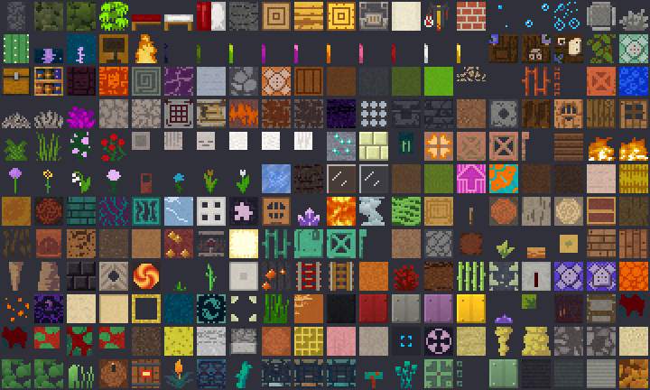
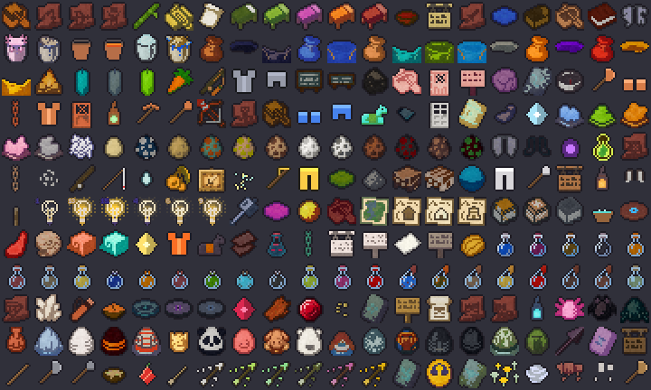
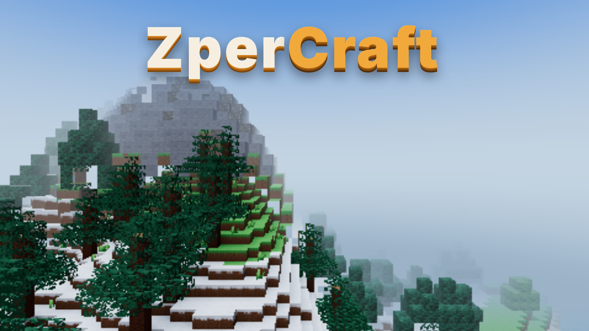

# ZperCraft Texturas (Minecraft Bedrock)

Resource pack con las texturas originales de ZperCraft, exportadas directamente del pintor de texturas del juego (`voxel/src/gfx/Atlas.ts` y `voxel/src/game/Items.ts`, rama `ccr-bed54efe-6zvh1l`).

**Instalar:** abre `release/ZperCraft_Texturas.mcpack` en el teléfono/PC → Minecraft lo importa solo → Ajustes → Recursos globales → activa *ZperCraft Texturas*.


## Equivalencias principales
| ZperCraft | Minecraft |
|---|---|
| Fresno (ash) | Roble |
| Pino | Abeto |
| Palma | Jungla |
| Plateado | Abedul |
| Escombro / musgoso | Piedra labrada / musgosa |
| Piedra profunda / pizarra | Pizarra profunda (cobbled/deepslate) |
| Solar (sunstone) | Oro |
| Azurita / herramientas azure | Diamante |
| Brillofragmento (glowshard) | Esmeralda |
| Escarcuarzo (frostquartz) | Lapislázuli |
| Rubelita | Redstone |
| Emberita | Netherita / cuarzo del Nether |
| Banco de trabajo / horno de arcilla / caja / barril de pólvora | Mesa de crafteo / horno / barril / TNT |
| Tela | Lana |
| Lámpara lumen | Piedra luminosa |
| Grano | Trigo |
| Dimensión de ceniza | Nether (basalto, netherrack, portal) |
| Piedra celeste | Piedra del End |

Los mapas de color de pasto/hojas se dejan en blanco para que Bedrock no vuelva a teñir los verdes de ZperCraft; el agua es gris para que tome el azul de cada bioma.

## Regenerar
Desde `voxel/` de ZperCraft: copia `tools/export-entry.ts` a `src/__export.ts`, añade `export { painters, P, ore };` al final de `src/gfx/Atlas.ts`, luego
```
npx esbuild src/__export.ts --bundle --format=iife --outfile=OUT/export.js
node tools/run.cjs OUT            # escribe OUT/raw/tiles y OUT/raw/items
python3 tools/build_pack.py OUT/raw release/zpercraft-icon-1024.png pack
```

---

# ZperCraft Completo (todos los bloques y objetos)

`release/ZperCraft_Completo.mcpack` reemplaza **todas** las texturas de bloques y objetos de Minecraft Bedrock 1.26 (≈2,270 texturas, más cofres, camas y armadura puesta) con el estilo de ZperCraft:

1. **Exactas de ZperCraft** (≈250): las texturas que existen en el juego, tal cual (tabla de arriba), más herramientas y armaduras de oro/cota de malla y azadas recoloreadas a partir de los íconos de ZperCraft.
2. **Repintadas con los algoritmos de ZperCraft** (≈250): menas, troncos, tablones, hojas, lana, concreto, terracota, bloques de metal, ladrillos, piedras, tierras y vidrios usan los mismos pintores de `Atlas.ts` con los colores de cada bloque.
3. **Filtro ZperCraft** (el resto): paleta plana y saturada, ruido de píxel y contorno oscuro en los objetos, conservando la silueta de cada cosa.

Las texturas vanilla solo se usan como referencia (colores, forma, tamaño); no se copian al pack.

Regenerar (necesita `resource_pack/textures` de github.com/Mojang/bedrock-samples y la carpeta `raw/` exportada arriba):
```
python3 tools/zperify.py <bedrock-samples>/resource_pack/textures OUT/raw release/zpercraft-icon-1024.png OUT/ZperCraft_Completo
```

| Bloques | Objetos |
|---|---|
|  |  |

---

# Menú de ZperCraft (incluido en los dos packs)



- **Logo:** `textures/ui/title.png` es el logo de ZperCraft ("Zper" crema + "Craft" ámbar con la sombra 3D), renderizado con el mismo CSS de `voxel/src/ui/style.css` (`tools/logo.cjs`).
- **Fondo del menú:** el panorama son 6 capturas reales de un mundo de ZperCraft a 90° (`tools/panorama.cjs` abre `voxel/release/zpercraft.html` en Chromium y gira la cámara). Se guarda en PNG y en HDR (`panoramahdr_*`) para Vibrant Visuals.
- **Interfaz:** `tools/ui_theme.py` recolorea ~1,675 texturas de `textures/ui` y `textures/gui` con la paleta del menú de ZperCraft: grises → azul marino/pizarra (mismo brillo, el texto sigue legible), verde → ámbar, azul → verde azulado.

Algunas pantallas nuevas de Bedrock (Ajustes, Crear mundo, Marketplace) están hechas con "Ore UI" y no se pueden cambiar con un resource pack.

Regenerar:
```
node tools/logo.cjs logo_raw.png            # luego ajustar a 1937x333 -> title.png
node tools/panorama.cjs voxel/release/zpercraft.html pano 0.3 1024
python3 tools/ui_theme.py <bedrock-samples>/resource_pack/textures uitheme
python3 tools/menu_assets.py <pack> uitheme title.png pano raw
```
